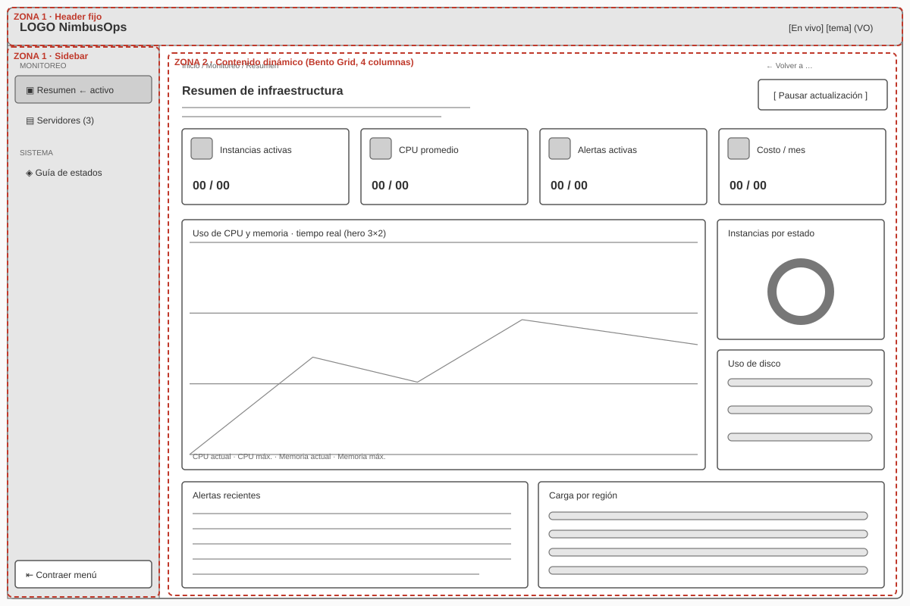
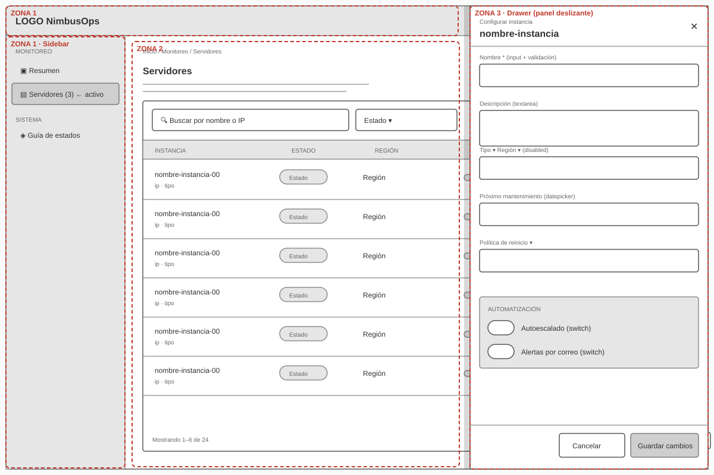
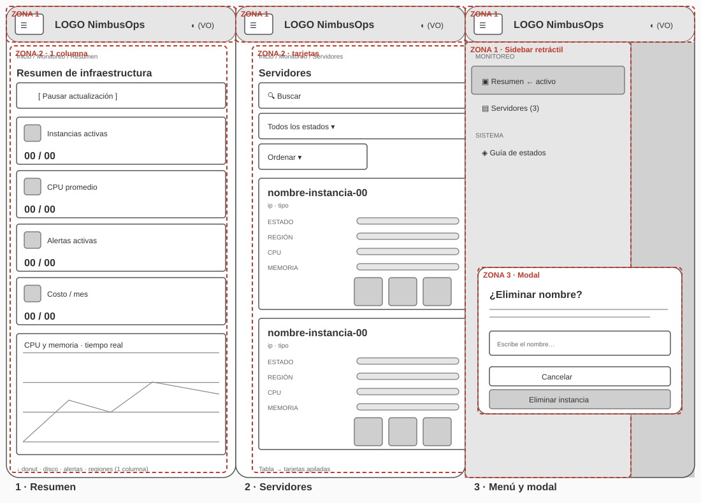

# Fase 1 · Wireframes estructurales (baja fidelidad)

Bocetos en escala de grises, sin estilo visual: solo **distribución espacial**. Las líneas rojas punteadas marcan las tres zonas de la interfaz.

| Zona | Contenido |
|---|---|
| **Zona 1 · Navegación** | Header fijo + sidebar (persistente en escritorio, retráctil en móvil). |
| **Zona 2 · Contenido dinámico** | Tarjetas de estado, gráficas y tabla de servidores. |
| **Zona 3 · Acciones críticas** | Drawer de configuración y modal de confirmación. |

## Escritorio — Resumen (Bento Grid de 4 columnas)

- Fila 1: cuatro KPIs de 1×1.
- Filas 2-3: gráfica principal (hero 3×2) junto a dona de estados y uso de disco (1×1 cada una).
- Fila 4: alertas recientes y carga por región (2×1 cada una).

## Escritorio — Servidores con Drawer (Zona 3)

- Barra de herramientas: búsqueda, filtro de estado y dropdown de orden.
- Tabla con acciones por fila (configurar, reiniciar, eliminar) y paginación.
- El drawer entra desde la derecha y contiene el formulario completo.

## Móvil — Resumen, Servidores (tarjetas), Menú y Modal

1. **Resumen**: una sola columna; las tarjetas se apilan por prioridad.
2. **Servidores**: la tabla se transforma en tarjetas con etiquetas por campo; acciones con botones de 44 × 44 px.
3. **Menú y modal**: el sidebar sale del lienzo con un velo oscuro; el modal ocupa casi todo el ancho con botones apilados.

## Del wireframe al código

| Wireframe | Implementación |
|---|---|
| Rejilla general header / sidebar / main | `.app` con `grid-template-areas` ([layout.css](../css/layout.css)) |
| Bento 4 columnas | `.bento` + `.bento__hero`, `.bento__wide` ([layout.css](../css/layout.css)) |
| Tabla → tarjetas | `.table` con `display:flex` móvil y `display:table-row` desde 768 px ([components.css](../css/components.css)) |
| Drawer y modal | `<dialog>` nativos ([overlays.css](../css/overlays.css)) |

Los SVG se pueden **importar a Figma** (arrastrar el archivo al lienzo) para usarlos como base del prototipo; ver [03-prototipo-figma.md](03-prototipo-figma.md).
