# Reporte técnico de validación · NimbusOps

Dashboard SPA responsivo de monitoreo de servidores e instancias cloud.
Tecnologías: HTML5 semántico, CSS nativo (Grid + Flexbox + variables) y JavaScript vanilla. **Sin Bootstrap, Tailwind ni ninguna librería.**

Las capturas se generaron con [tools/capture.mjs](../tools/capture.mjs) (Chrome headless), por lo que son reproducibles. Los resultados de las comprobaciones automáticas están en [capturas/auditoria.json](capturas/auditoria.json).

---

## 1. Los 5 estados de cada control

Vista **Guía de estados** (`#/guia`): cada fila es un control y cada columna uno de los cinco estados. *Hover* y *Focus* se fuerzan con las clases `.is-hover` / `.is-focus`, que replican exactamente los pseudo-estados reales (`:hover`, `:focus-visible`).

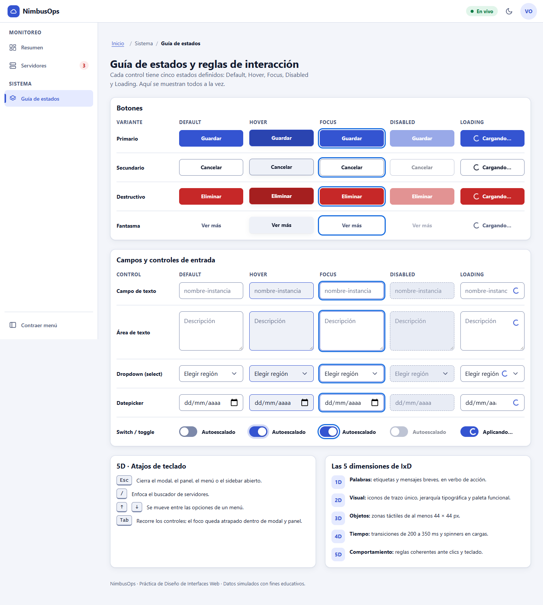

| Estado | Cómo se implementa | Evidencia en la captura |
|---|---|---|
| **Default** | Tokens base (`--btn-bg`, `--border-input`). | Primera columna. |
| **Hover** | Fondo más marcado + elevación de 1 px (`translateY(-1px)` + sombra); en campos, borde y fondo de acento. | Segunda columna. |
| **Focus** | `outline: 3px solid var(--focus)` con `outline-offset` y `:focus-visible` (contorno visible solo con teclado). | Tercera columna: halo azul. |
| **Disabled** | Atributo `disabled`, opacidad reducida, `cursor: not-allowed`; en campos, borde discontinuo. | Cuarta columna. |
| **Loading** | Spinner + etiqueta ("Cargando…"), `aria-busy="true"` y `aria-disabled="true"` (no recibe clics, **bloquea el reenvío** pero sigue enfocable). | Quinta columna. |

Los estados `Loading` también se usan en la aplicación real:

- Botón **Guardar cambios** del drawer (1.2 s) y botones **Eliminar / Reiniciar** del modal (1.5 s).
- Campo **Nombre** del drawer: validación asíncrona de disponibilidad con spinner interno.
- Switch **Autoescalado**: verificación de cuota con spinner en el pulgar.

> Controles cubiertos: botones (primario, secundario, destructivo, fantasma), campo de texto, área de texto, dropdown (`select`), datepicker (`input type="date"`) y switch (`role="switch"`). Además, hay un dropdown propio accesible (menú *Ordenar*).

---

## 2. Vista responsiva: móvil y escritorio (Mobile-First)

Las reglas base de [layout.css](../css/layout.css) son para móvil; después se expande con `@media (min-width: 640px | 768px | 1024px | 1280px)`.

| Punto de corte | Cambio |
|---|---|
| `< 768 px` | 1 columna; sidebar fuera de lienzo (hamburguesa + velo); tabla en tarjetas. |
| `≥ 640 px` | Bento de 2 columnas. |
| `≥ 768 px` | Rejilla de 2 columnas (sidebar persistente, contraído a iconos en tablet); tabla real. |
| `≥ 1024 px` | Sidebar expandido por defecto; más espaciado. |
| `≥ 1280 px` | Bento de **4 columnas** con celdas hero (3×2) y alta (1×2). |

### Escritorio (1440 px)

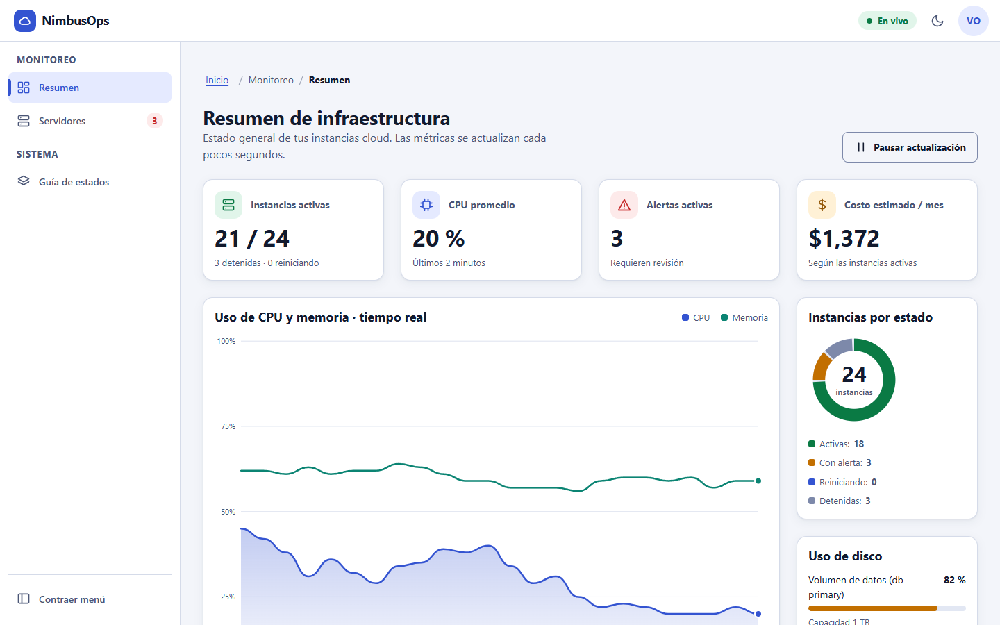
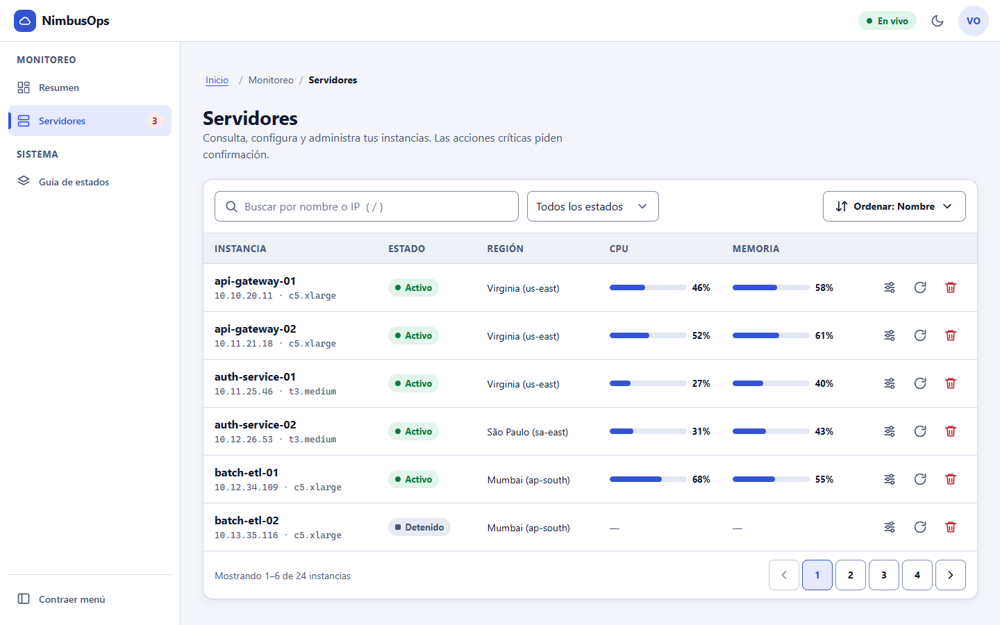

### Tablet (820 px) — sidebar contraído a iconos

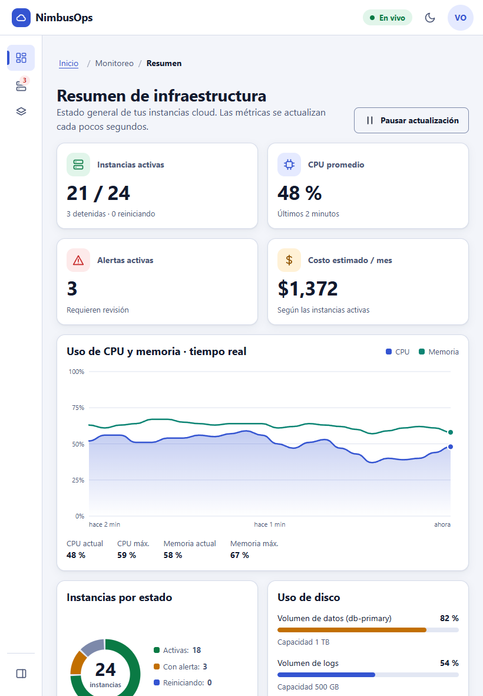

### Móvil (390 px)

| Resumen | Menú lateral | Servidores (tarjetas) |
|---|---|---|
| 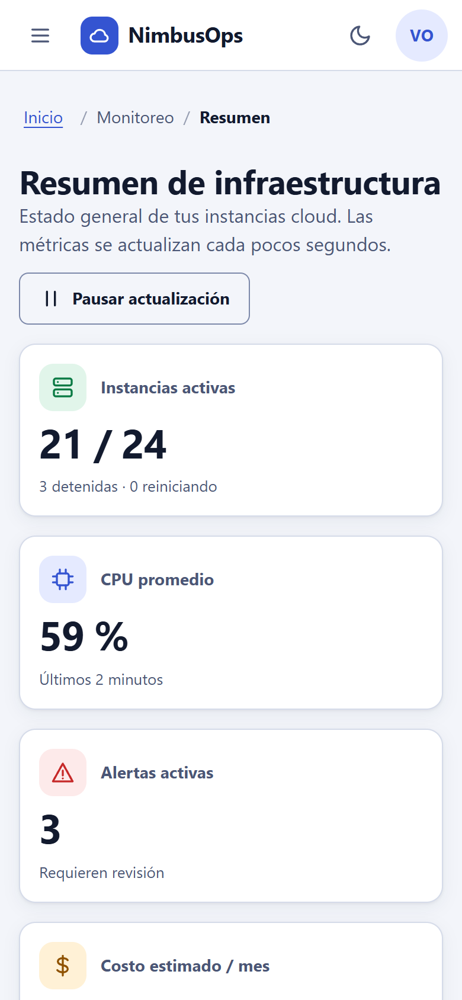 | 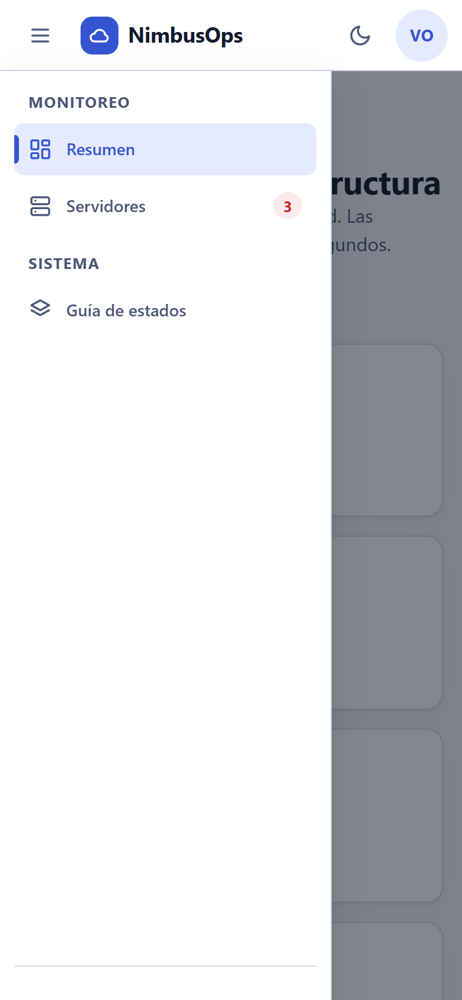 | 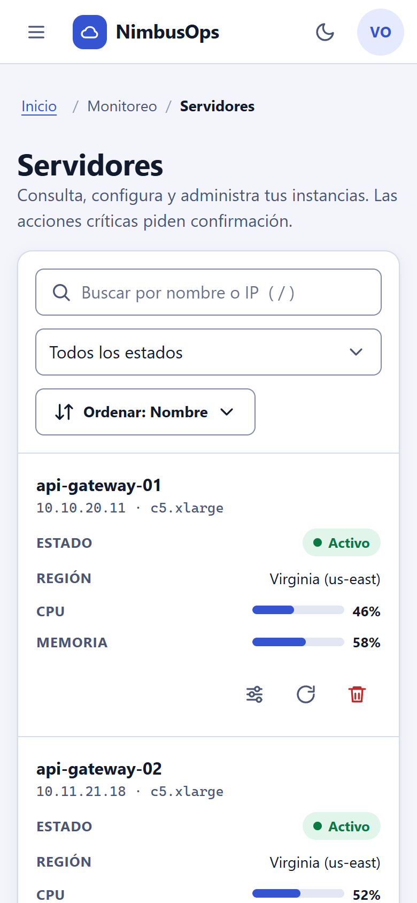 |

| Drawer | Modal de confirmación |
|---|---|
| 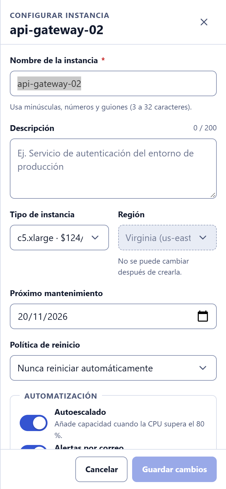 | 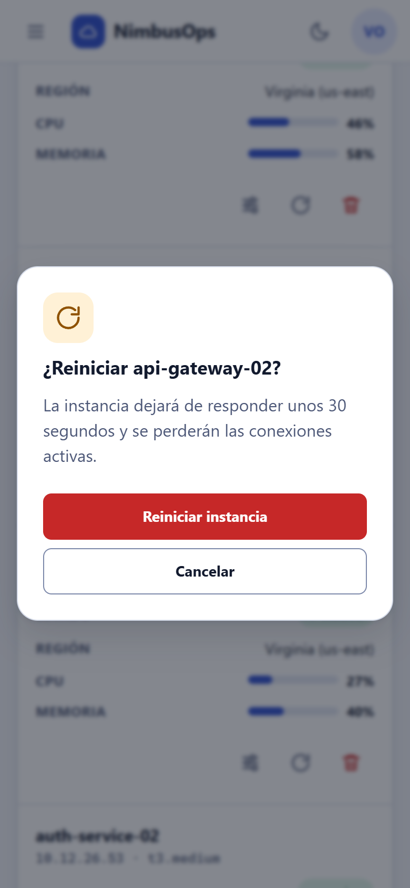 |

### Zona 3 en escritorio

| Drawer de configuración | Modal con confirmación por nombre |
|---|---|
| 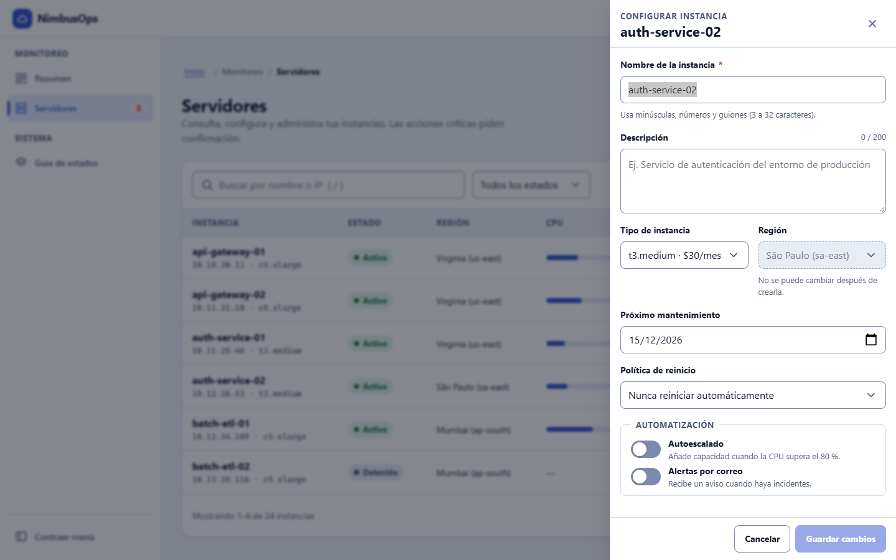 | 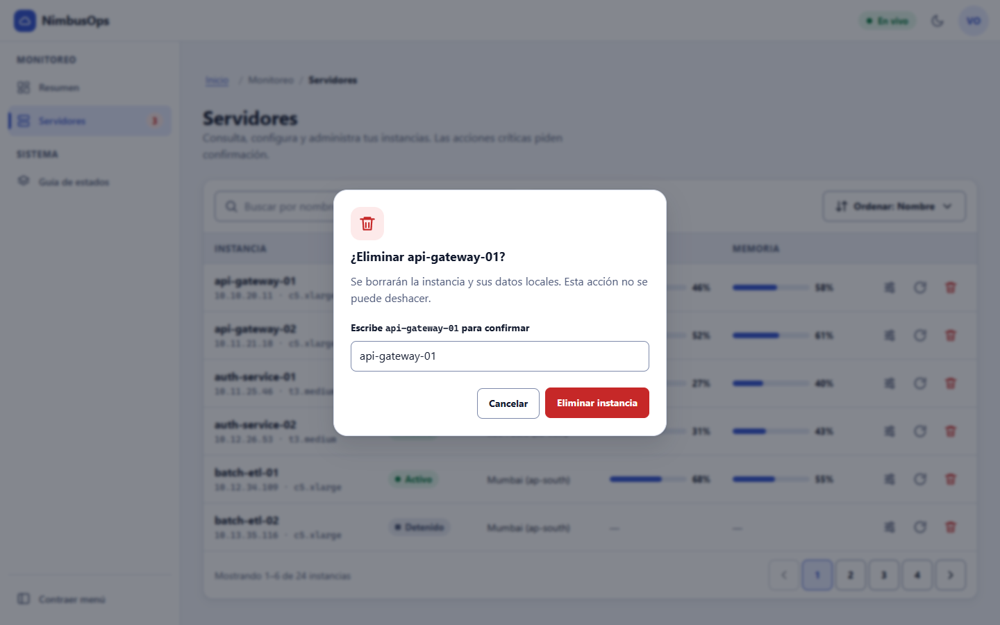 |

### Comprobaciones automáticas (viewports 360, 390, 820 y 1440 px)

| Comprobación | Resultado |
|---|---|
| Desbordamiento horizontal en las 3 vistas | **Ninguno** (`scrollWidth == innerWidth` en todos los casos). |
| Elementos interactivos visibles con área menor a 44 × 44 px | **0** en todas las vistas y tamaños. |
| Errores de consola / excepciones durante el recorrido completo | **0**. |
| `Esc` cierra drawer y modal | Verificado (el diálogo queda cerrado tras el evento `cancel`). |

---

## 3. Modo oscuro nativo

La paleta vive en variables CSS (`:root`) dentro de [variables.css](../css/variables.css) y se conmuta de dos maneras:

1. **Automática**: `@media (prefers-color-scheme: dark)` aplica la paleta oscura a `:root:not([data-theme="light"])`.
2. **Manual**: el botón de la cabecera fija `data-theme="dark|light"` en `<html>`, lo guarda en `localStorage` y prevalece sobre el sistema. Un pequeño script en `<head>` lo aplica antes de pintar (sin parpadeo).

| Oscuro por preferencia del sistema (sin tocar nada) | Oscuro por toggle manual |
|---|---|
| 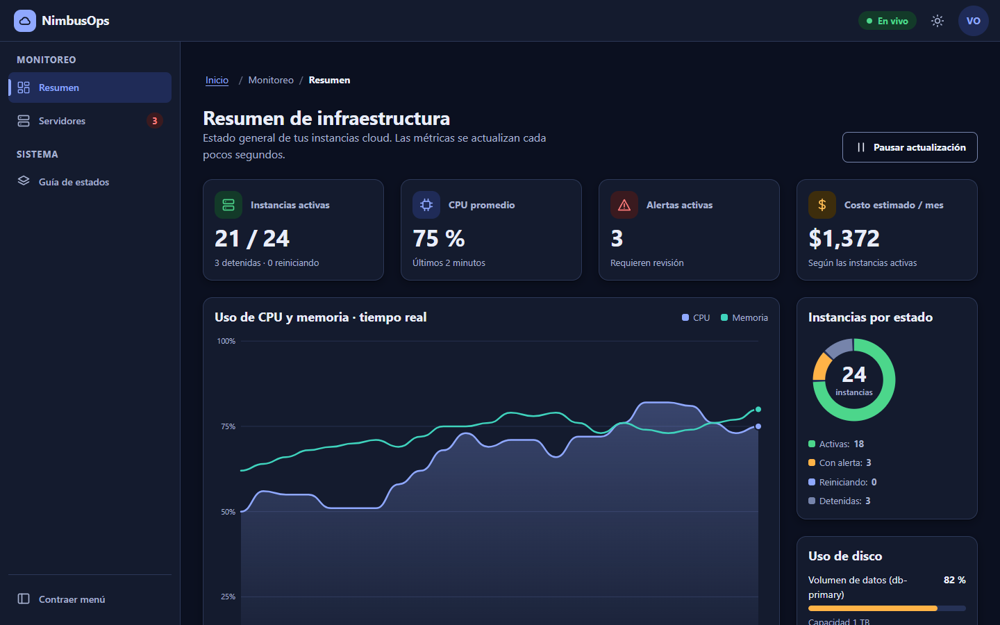 | 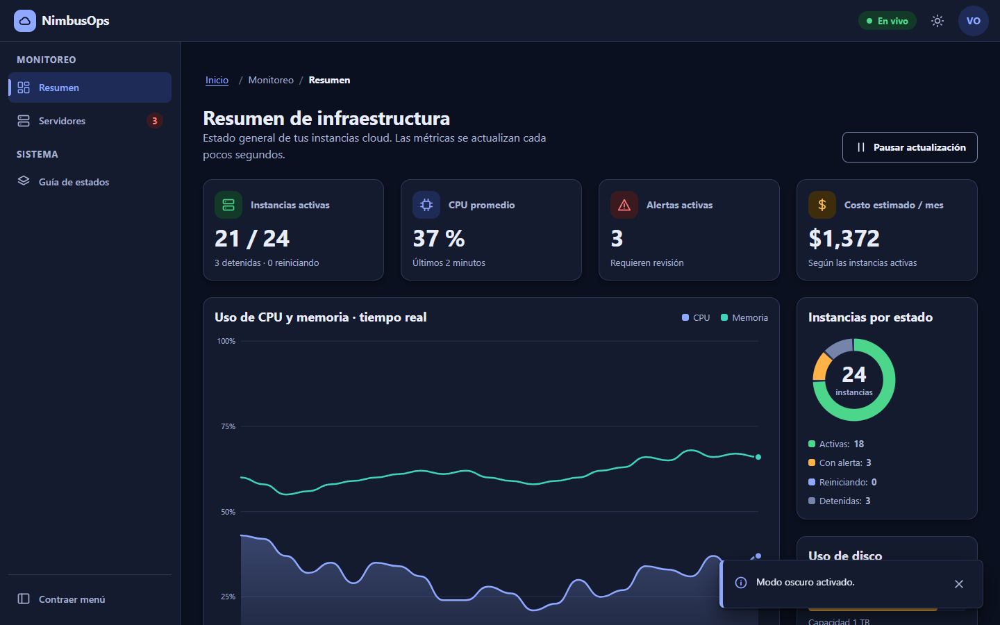 |

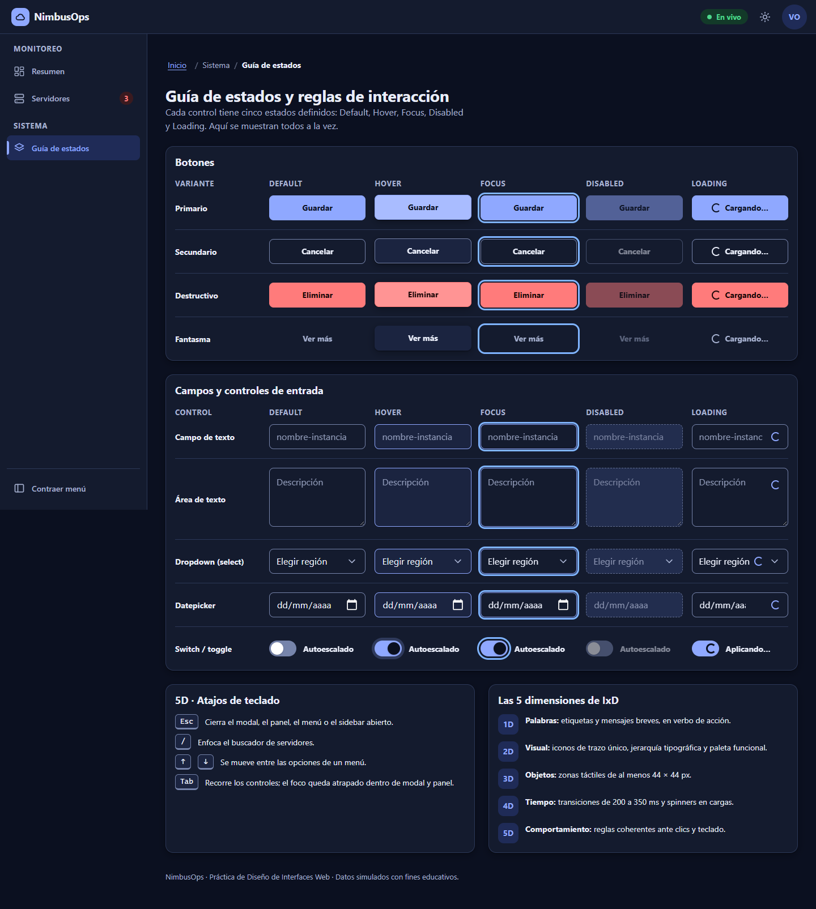

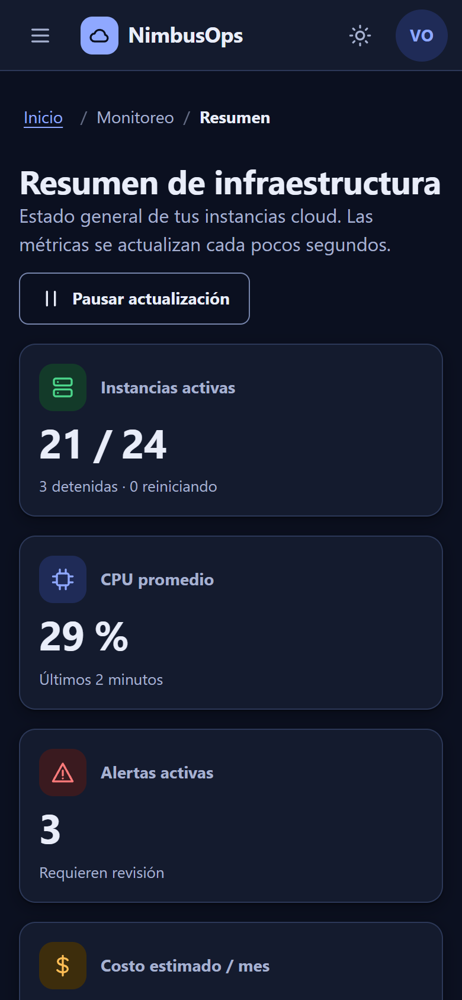

### Contraste (WCAG 2.1, calculado con la fórmula de luminancia relativa)

| Par | Claro | Oscuro | Requisito |
|---|---|---|---|
| Texto / superficie | 17.3 : 1 | 14.6 : 1 | 4.5 : 1 |
| Texto secundario / superficie | 7.3 : 1 | 8.0 : 1 | 4.5 : 1 |
| Botón primario (texto / fondo) | 6.3 : 1 | 8.3 : 1 | 4.5 : 1 |
| Botón destructivo | 5.6 : 1 | 7.8 : 1 | 4.5 : 1 |
| Insignia "Activo" | 4.8 : 1 | 6.8 : 1 | 4.5 : 1 |
| Insignia "Con alerta" | 5.6 : 1 | 8.1 : 1 | 4.5 : 1 |
| Borde de campos (componente UI) | 3.5 : 1 | 4.6 : 1 | 3 : 1 |
| Anillo de foco | 4.8 : 1 | 8.1 : 1 | 3 : 1 |

---

## 4. Checklist de las 5 dimensiones de IxD

| Dim. | Criterio de la práctica | Cumple | Evidencia en el proyecto |
|---|---|:---:|---|
| **1D · Palabras** | Etiquetas, microcopia y mensajes claros y concisos | ✅ | Botones con verbo de acción ("Guardar cambios", "Eliminar instancia", "Quitar filtros"). Estados con texto ("Activo", "Reiniciando…"). Errores que dicen qué hacer: *"Usa solo minúsculas, números y guiones."*, *"Ya existe una instancia con ese nombre. Prueba con otro."* Modal con el nombre de la instancia y la consecuencia: *"Esta acción no se puede deshacer."* |
| **2D · Representaciones visuales** | Iconografía clara y consistente, jerarquía tipográfica legible, paleta funcional | ✅ | Sprite SVG propio de 24 px con trazo de 2 px ([index.html](../index.html)). Escala tipográfica 13–34 px en variables. Color con significado (verde activo, ámbar alerta, rojo destructivo) **siempre acompañado de forma y texto** (círculo, rombo, cuadrado, spinner) para no depender solo del color. |
| **3D · Objetos físicos** | Zonas táctiles ≥ 44 × 44 px y precisión con mouse | ✅ | `--tap: 44px` aplicado a botones, enlaces del sidebar, migas de pan, switches, selects e inputs. Auditoría automática: **0** objetivos menores a 44 px en 4 viewports. Entradas con `font-size: 16px` (sin zoom en iOS), `touch-action: manipulation`, hover solo donde hay puntero. |
| **4D · Tiempo** | Transiciones de 200–350 ms y spinners en cargas | ✅ | Tokens `--t-fast: 200ms`, `--t-base: 250ms`, `--t-slow: 350ms`. Hover de botones 200 ms; hover de tarjetas 250 ms; apertura de drawer 350 ms / cierre 250 ms; modal 250 ms; toasts 250 ms; cambio de vista 350 ms. Spinners en botones, campos y switches (giro continuo de 700 ms, es un indicador, no una transición). Con `prefers-reduced-motion` las duraciones bajan a ~0. |
| **5D · Comportamiento** | Reglas lógicas ante clics y atajos; consistencia operativa | ✅ | `Esc` cierra modal, drawer, menú y sidebar móvil; clic en el fondo también cierra; el foco queda atrapado en los diálogos (`<dialog>` modal) y regresa al elemento que los abrió. `/` enfoca el buscador. Flechas, `Inicio`, `Fin` en el dropdown. Botones en *Loading* ignoran clics (anti-doble envío) y los diálogos con operación en curso no se pueden cerrar. *Guardar* permanece deshabilitado hasta que hay cambios válidos. *Eliminar* exige escribir el nombre. El foco inicial en acciones destructivas simples es *Cancelar*. |

### Zona 1 — "¿Dónde estoy? ¿De dónde vengo? ¿A dónde puedo ir?"

| Pregunta | Respuesta en la interfaz |
|---|---|
| ¿Dónde estoy? | Elemento del sidebar resaltado (`aria-current="page"` + barra lateral), migas de pan `Inicio / Monitoreo / Servidores`, título `<h1>` y `<title>` del documento. |
| ¿De dónde vengo? | Enlace **"Volver a …"** con la vista anterior de la sesión y migas de pan con enlace a *Inicio*. |
| ¿A dónde puedo ir? | Sidebar persistente con grupos *Monitoreo* y *Sistema*; insignia con el número de alertas activas en *Servidores*. |

---

## 5. Cumplimiento de la práctica (resumen)

| Requisito | Estado |
|---|---|
| HTML5 semántico, CSS nativo, JS vanilla, sin frameworks CSS | ✅ |
| Mobile-first con `@media (min-width)` | ✅ |
| CSS Grid: layout macro + Bento Grid | ✅ |
| Flexbox: navbar, grupos de botones, iconos, tarjetas | ✅ |
| Zona 1: header fijo + sidebar persistente/retráctil + breadcrumbs | ✅ |
| Zona 2: tarjetas, gráficas, tabla con filtros y paginación | ✅ |
| Zona 3: Drawer + Modal de confirmación | ✅ |
| Formulario: texto, textarea, datepicker, switches, dropdowns | ✅ |
| 5 estados por control | ✅ |
| Modo oscuro (`:root` + `prefers-color-scheme` + toggle) | ✅ |
| Microinteracciones | ✅ |
| Documentación de las 5 dimensiones IxD | ✅ |
| User Persona y wireframes (móvil y escritorio) | ✅ ([ver docs](01-user-persona.md)) |
| Prototipo navegable en Figma con enlace público | ✅ [Prototipo en Figma](https://www.figma.com/proto/RTPtyK3HE15my6DMKe9wKy/NimbusOps---Prototipo?node-id=1-6&starting-point-node-id=1%3A6&scaling=min-zoom&content-scaling=fixed&page-id=0%3A1) (4 frames de escritorio, flujo y `Esc`; alcance en [03-prototipo-figma.md](03-prototipo-figma.md)) |
| Repositorio en GitHub/GitLab con commits ordenados | ⏳ Estructura y README listos; falta crear el remoto (ver README) |

### Limitaciones conocidas

- Los datos son simulados (no hay backend); el reinicio y la eliminación operan solo en memoria y se restauran al recargar.
- La gráfica en vivo genera datos aleatorios; se puede pausar desde el encabezado de la vista.
- El selector de fecha usa el calendario nativo del navegador, cuya apariencia varía entre navegadores.
- Probado con Chrome (Chromium) mediante automatización; no se verificó en Safari ni Firefox.
